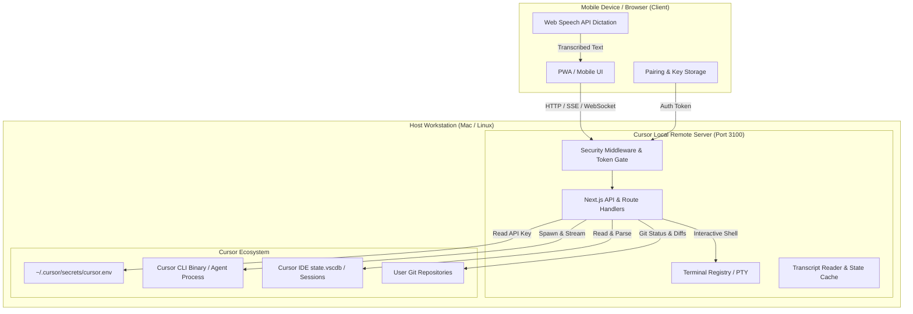

# Cursor Local Remote: Product Requirements Document & Architecture Specification

**Project ID:** `cd5ab6d5-3327-4fe6-b896-c9cd91d054dd`  
**Owner:** `mishraroshanraj@gmail.com`  
**Repository:** `cursor-local-remote`  
**Status:** Baseline Verified (9 verified requirements, 1 draft voice requirement)  

---

## Executive Summary

Cursor Local Remote (CLR) is a local-network progressive web application (PWA) enabling developers to monitor, nudge, and steer Cursor CLI agent sessions directly from a smartphone, tablet, or secondary browser. CLR bridges the gap between desktop-bound autonomous coding and mobile developer workflows, providing instant QR-code local network pairing, real-time token/tool-call streaming, workspace switching, interactive web terminal access, git operations, and desktop-grade voice dictation without relying on third-party cloud intermediaries.

---

## Part I: Business Requirements Narrative

### 1. Problem Statement
Autonomous AI coding agents in Cursor are increasingly capable of long-running, multi-step engineering tasks (running test suites, refactoring repositories, auditing codebases). However, monitoring these tasks currently binds developers to their physical desktop or laptop screen. Existing workarounds either lack real-time visibility into tool calls and diffs, or require exposing local files to external proprietary cloud relays.

### 2. Stakeholders & User Roles
- **Remote Developer (`SH-001`):** A software engineer who initiates autonomous coding sessions on their primary workstation and requires mobile oversight while away from their desk (e.g., cooking, taking breaks, or moving around the home/office network).
  - *Core Outcomes:* Instant zero-configuration pairing, zero lag on agent outputs, reliable audio/visual completion alerts, and safe local-network access.

### 3. Proposed Solution
CLR runs a lightweight Next.js server locally on the host machine (default port 3100). The server directly talks to the local Cursor CLI binary and filesystem:
- **Zero Cloud Middleman:** Communication stays on the local Wi-Fi network, with optional encrypted Cloudflare Access Zero Trust tunneling for external access.
- **Bi-Directional Interaction:** Users can review live streamed output, abort runaway loops, trigger prompt retries, view file diffs, execute terminal commands, and dictate prompts using natural speech.

### 4. Guiding Principles & Constraints
- **Zero-Bloat Foundation:** Direct communication with the local Cursor binary; no cloud account requirements.
- **Mobile-First Ergonomics:** 44px touch targets (`--clr-touch-min`), touch-scrolling with pin-to-bottom mechanics, and virtual keyboard-aware layouts.
- **Security-First Network Policy:** Mandatory authentication keys on untrusted networks; constant-time token verification in middleware.

---

## Part II: System Architecture & Data Flow

---

## Part III: Coded Requirements

### 1. Pairing & Network Security

#### `REQ-002` (Pairing: Terminal QR Code & Mobile Modal)
- **Requirement:** The server must generate an ASCII QR code in the terminal and a modal in the web UI containing the local network URL and access token.
- **Lifecycle:** `verified` (locked)
- **Priority:** Must | **Category:** Functional, Usability
- **Code References:** `bin/cursor-remote.mjs`, `src/components/qr-modal.tsx`, `src/lib/network.ts`
- **Rationale:** Allows developers to quickly connect mobile phones without manually looking up or typing LAN IP addresses.
- **Risk:** If local IP detection fails, mobile devices cannot resolve the server address over Wi-Fi.

#### `REQ-009` (Security Middleware & Access Key Protection)
- **Requirement:** The server must enforce access key authentication via middleware and support Cloudflare Access validation.
- **Lifecycle:** `verified` (locked)
- **Priority:** Must | **Category:** Security, Constraint
- **Code References:** `src/middleware.ts`, `src/lib/cloudflare-access.ts`, `bin/cursor-remote.mjs`
- **Rationale:** Prevents unauthorized network peers on shared Wi-Fi networks from invoking arbitrary shell commands or agent prompts.
- **Risk:** Unprotected local ports allow anyone on the same Wi-Fi network to execute code on the host machine.

---

### 2. Agent Execution & Streaming

#### `REQ-001` (CLI Bridge & Environment Key Loader)
- **Requirement:** The CLI server must load the Cursor API key from local environment/secrets and correctly format arguments and model parameters when spawning the Cursor agent.
- **Lifecycle:** `verified` (locked)
- **Priority:** Must | **Category:** Functional
- **Code References:** `bin/dev.mjs`, `src/cursor-cli.mjs`
- **Tests:** `tests/cursor-cli.test.mjs`
- **Rationale:** Ensures local remote web UI can authenticate and spawn Cursor CLI agent sessions securely.
- **Risk:** If API key parsing or argument construction fails, remote prompt invocations fail silently or error out.

#### `REQ-010` (Mobile Voice Dictation & Audio Feedback)
- **Requirement:** The mobile composer must provide desktop-grade speech-to-text dictation with live interim transcript streaming, visual audio activity feedback, cursor-position text insertion, and mobile touch ergonomics.
- **Lifecycle:** `draft` (target implementation)
- **Priority:** Should | **Category:** Functional, Usability
- **Component:** `composer-voice`, `mobile-ui`
- **Rationale:** Enables friction-free prompt input on mobile phones matching desktop voice dictation quality.
- **Risk:** Poor audio streaming or sudden recognition drops create frustrating transcription errors on mobile keyboards.

---

### 3. Workspace & Session Management

#### `REQ-003` (Multi-Workspace Discovery & Starred Repos)
- **Requirement:** The system must discover existing Cursor workspaces, provide an API to switch projects, and allow starring frequent repositories.
- **Lifecycle:** `verified` (locked)
- **Priority:** Must | **Category:** Functional
- **Code References:** `src/lib/cursor-workspaces.ts`, `src/lib/workspace-paths.server.ts`, `src/app/api/projects/route.ts`, `src/components/session-sidebar.tsx`
- **Rationale:** Enables developers to manage and execute agent workflows across multiple repositories from a single mobile dashboard.
- **Risk:** Incomplete workspace discovery leaves developer projects inaccessible from the remote UI.

#### `REQ-006` (Session Store, Resumption, & Transcript Export)
- **Requirement:** The system must load past agent sessions, allow resuming previous conversations, and export formatted transcripts.
- **Lifecycle:** `verified` (locked)
- **Priority:** Must | **Category:** Functional
- **Code References:** `src/lib/session-store.ts`, `src/lib/transcript-reader.ts`, `src/lib/export.ts`, `src/app/api/sessions/route.ts`
- **Rationale:** Preserves agent continuity and allows developers to review, resume, or document past agent decisions.
- **Risk:** Corrupted session JSON files could crash the reader if parsing is not defensive.

---

### 4. Developer Tools & Notifications

#### `REQ-004` (Integrated Git Control Panel)
- **Requirement:** The system must provide an integrated Git management panel allowing developers to inspect diffs, stage files, commit, and push/pull.
- **Lifecycle:** `verified` (locked)
- **Priority:** Should | **Category:** Functional
- **Code References:** `src/components/git-panel.tsx`, `src/app/api/git/route.ts`
- **Rationale:** Allows developers to review agent-generated diffs and commit or push changes immediately from mobile.
- **Risk:** Git command execution failures or conflicts could corrupt branch state if unhandled.

#### `REQ-005` (In-Browser Interactive Terminal)
- **Requirement:** The system must provide an interactive browser terminal interface tied to the active project workspace.
- **Lifecycle:** `verified` (locked)
- **Priority:** Should | **Category:** Functional
- **Code References:** `src/components/terminal-panel.tsx`, `src/lib/terminal-registry.ts`, `src/app/api/terminal/route.ts`
- **Rationale:** Provides direct shell access to run scripts, tests, or diagnostic tools from phone or tablet.
- **Risk:** Zombie terminal sessions could leak memory or system resources if not cleaned up properly.

#### `REQ-007` (Background Alerts & External Webhooks)
- **Requirement:** The system must trigger tab title flashes, audio chimes, and optional webhook push notifications when agent tasks finish.
- **Lifecycle:** `verified` (locked)
- **Priority:** Should | **Category:** Functional, Usability
- **Code References:** `src/lib/webhooks.ts`, `src/app/api/notifications/route.ts`, `src/components/chat-container.tsx`
- **Rationale:** Alerts developer when a long-running coding task finishes so they do not have to continuously stare at the screen.
- **Risk:** Missed notifications delay developer response to agent questions or errors.

#### `REQ-008` (PWA Manifest & Mobile Viewport Handling)
- **Requirement:** The application must support PWA installation and provide responsive, touch-friendly layouts for mobile screens.
- **Lifecycle:** `verified` (locked)
- **Priority:** Should | **Category:** Usability
- **Code References:** `src/app/manifest.ts`, `src/components/pwa-install.tsx`, `src/app/layout.tsx`, `src/app/globals.css`
- **Rationale:** Delivers a clean native-feeling mobile experience for full-screen phone coding sessions.
- **Risk:** Virtual keyboard popups on mobile could obscure chat inputs without dynamic viewport handling.

---

## Part IV: Definition of Done (DoD) Matrix

| Requirement Code | Acceptance Criteria Summary | Verification Method |
|---|---|---|
| **REQ-001** | API key resolved from `~/.cursor/secrets/cursor.env`; arguments placed before prompt; auto/default models stripped. | Automated tests in `tests/cursor-cli.test.mjs` |
| **REQ-002** | ASCII QR generated in terminal with local LAN IP and auth token; modal available in web UI; graceful fallback. | CLI startup smoke test |
| **REQ-003** | Cursor workspaces discovered from `~/.cursor`; project switching without restart; star persistence. | Workspace API integration test |
| **REQ-004** | Git status and diffs displayed; staging, custom commit, and push/pull functional. | Manual UI test & API validation |
| **REQ-005** | Interactive pty/shell spawned in workspace; I/O streamed; inactive processes cleaned up. | Terminal API session test |
| **REQ-006** | Historical transcripts read; previous sessions resumed; exports to Markdown/JSON. | Session store reader test |
| **REQ-007** | Flashes tab title ("Done! - CLR"); plays audio chime; dispatches webhook payload. | Browser background event test |
| **REQ-008** | Compliant PWA manifest; 44px min touch targets; responsive layout with active mobile virtual keyboard. | Mobile PWA installation audit |
| **REQ-009** | Validates access token in query/header/cookie; blocks unauthorized LAN peers; supports Cloudflare Access headers. | Middleware unit & security test |
| **REQ-010** | 44px touch mic button; real-time interim transcript streaming; cursor-position insertion; visual recording badge. | Speech recognition component test |

---

## Part V: Traceability Matrix

| Story Code | Story Summary | Target Requirement | Implementation Status | Test Coverage |
|---|---|---|---|---|
| **S-001** | QR code mobile pairing | `REQ-002` | `verified` | CLI startup validation |
| **S-002** | Real-time agent streaming & diffs | `REQ-001` | `verified` | `tests/cursor-cli.test.mjs` (5 passing) |
| **S-003** | Multi-project workspace switching | `REQ-003` | `verified` | API route integration |
| **S-004** | Mobile Git operations panel | `REQ-004` | `verified` | UI component test |
| **S-005** | Interactive web terminal | `REQ-005` | `verified` | Process registry test |
| **S-006** | Session history & resumption | `REQ-006` | `verified` | Store reader test |
| **S-007** | Background notifications & webhooks | `REQ-007` | `verified` | Webhook dispatch test |
| **S-008** | PWA home screen installation | `REQ-008` | `verified` | Manifest schema test |
| **S-009** | Access key security middleware | `REQ-009` | `verified` | Middleware intercept test |
| **S-010** | Desktop-grade mobile voice dictation | `REQ-010` | `draft` | Pending implementation |
